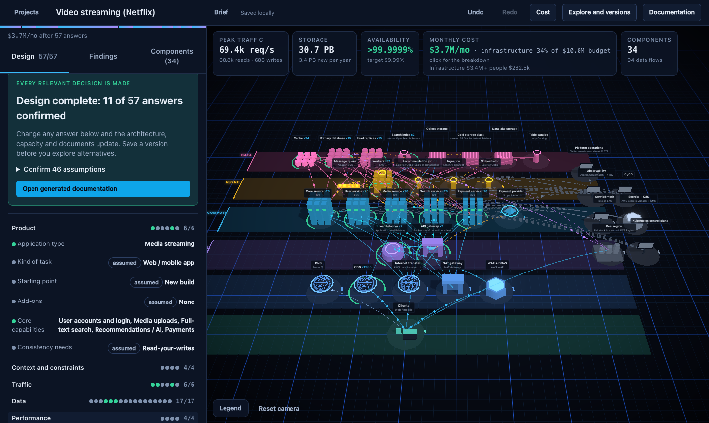
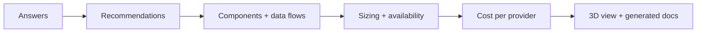
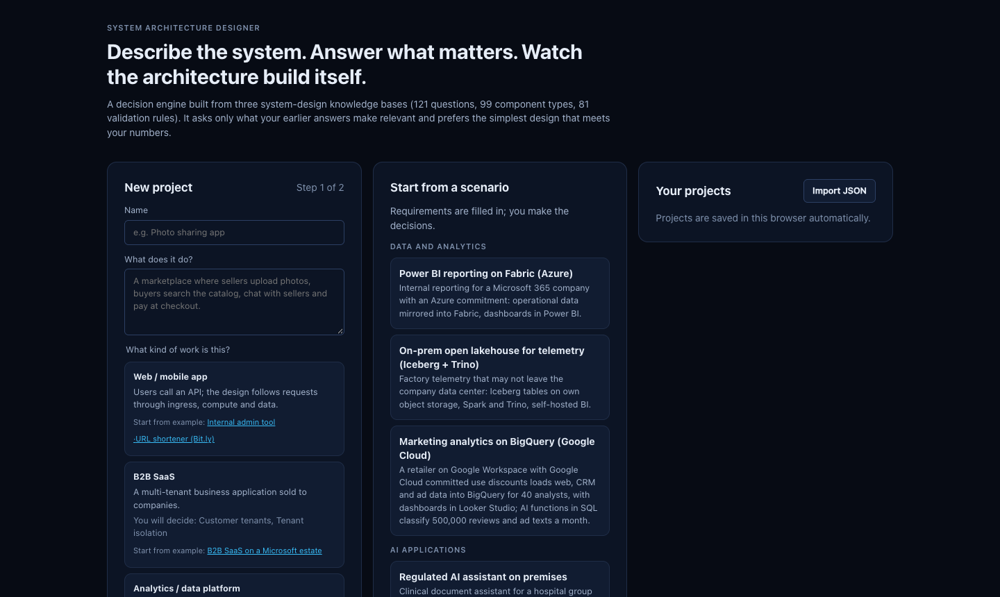
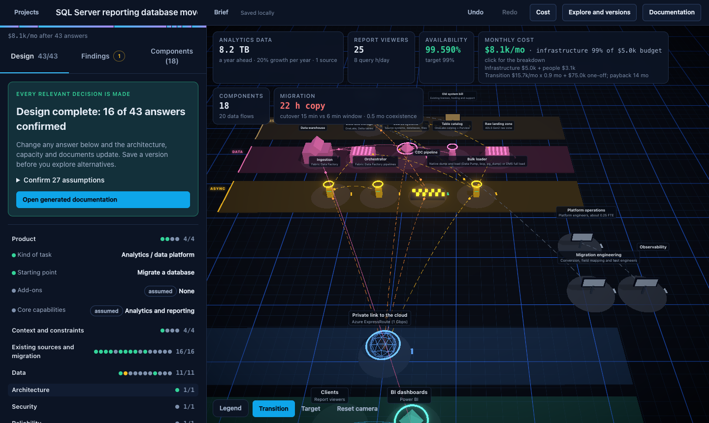
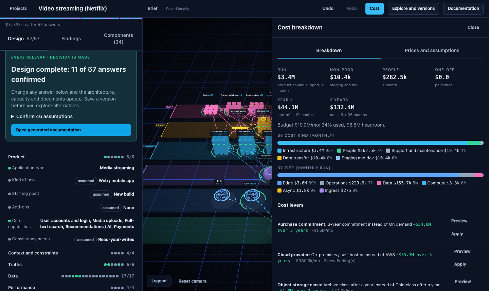
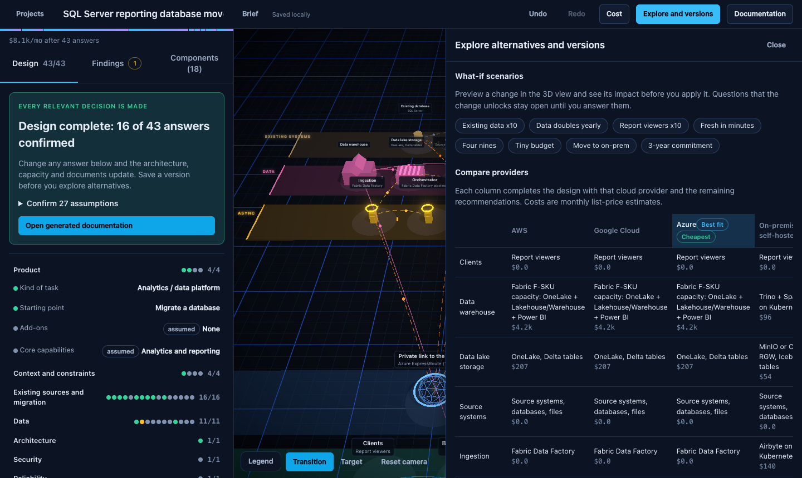

# System Architecture Designer

Answer a few questions, get a priced architecture you can walk around in 3D.





| Start from a scenario or a brief | Migrate into a data platform |
|---|---|
|  |  |
| **Monthly cost, people and one-off** | **Compare AWS, Azure, Google Cloud and on-prem** |
|  |  |

## Run

```bash
cd architect
npm install
npm run dev
```

Open http://localhost:5173.

## Add to the repo

```bash
git checkout -b my-change
cd architect
npm run typecheck && npm test && npm run lint && npm run build
git push -u origin my-change
```

Then open a pull request.

- Questions, components, prices and rules live in `architect/src/knowledge/`; scenarios in `scenarios.ts`.
- After a UI change, refresh the screenshots with the dev server on port 5174: `node scripts/readme-screenshots.mjs`.
- Engine details: [docs/decision-engine.md](docs/decision-engine.md).
